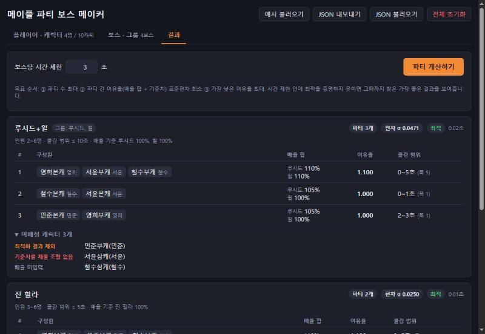
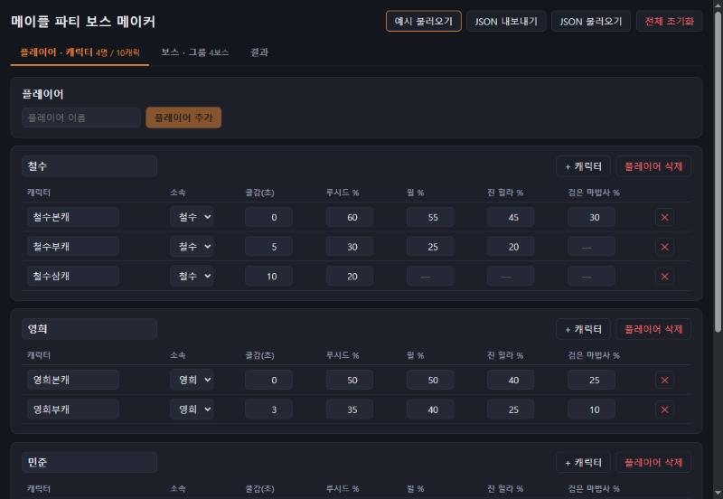
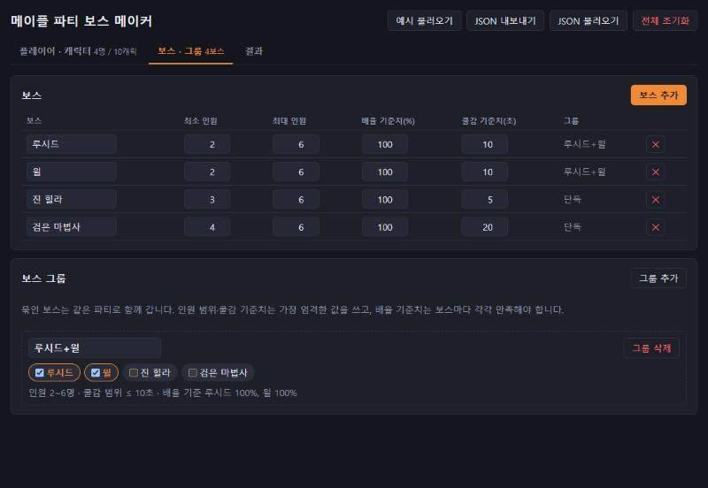
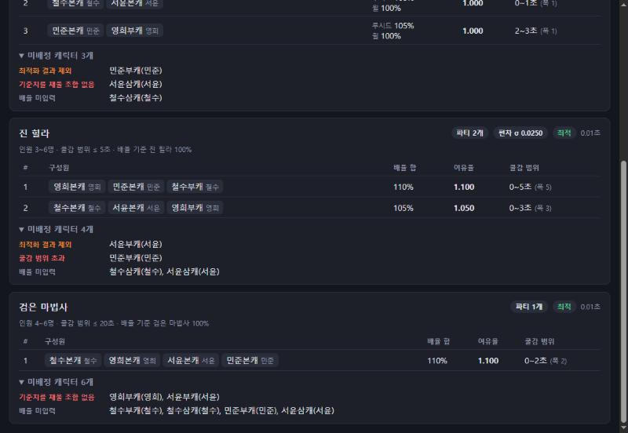
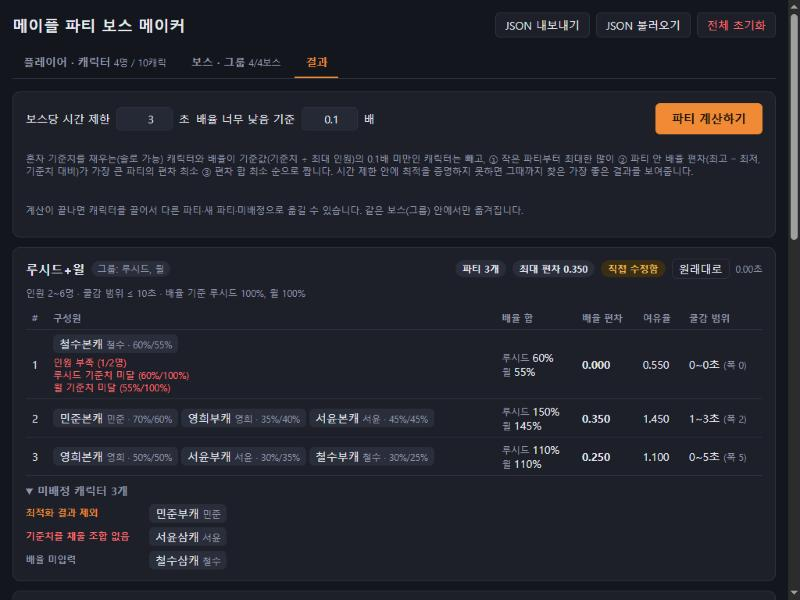
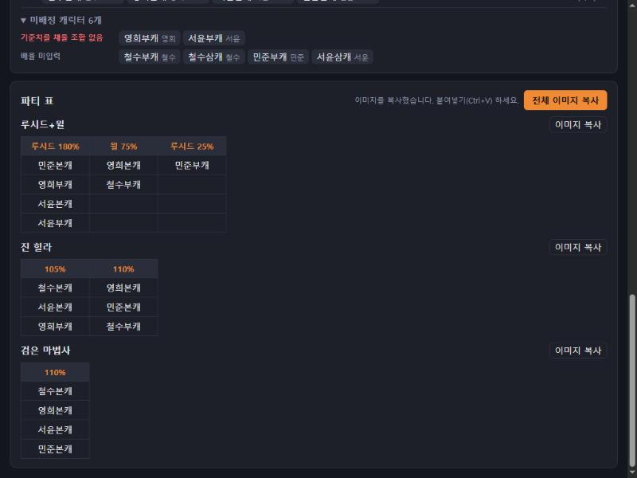

# 메이플 파티 보스 메이커

메이플스토리 보스 파티를 자동으로 짜 주는 웹앱입니다.
플레이어·캐릭터·보스 정보를 입력하면, 보스(또는 보스 그룹)마다 **배율 높은 캐릭터부터** 태우고, **파티를 최대한 많이**, 그리고 **파티원끼리 전력이 고르게** 나눕니다.



## 주요 기능

- 플레이어 · 캐릭터 · 보스 · 보스 그룹 추가/수정/삭제
- 캐릭터별 쿨타임 감소(초)와 보스별 배율(%) 입력 — 배율 칸을 비우면 그 보스에는 참여하지 않음
- 환산주스탯 「효율∙보스컷」 페이지를 붙여넣으면 그 캐릭터의 보스별 배율을 자동으로 채움
- 보스 그룹: 여러 보스를 같은 파티로 묶어서 계산
- 같은 보스의 난이도(익스트림·카오스·하드·노말·이지)를 묶어 표시하고, 한 캐릭터는 같은 보스에서 한 난이도에만 배정 (높은 난이도부터 계산)
- **배율 순위 우선**: 배율(그룹이면 보스 배율 평균)이 높은 캐릭터가 먼저 파티에 들어가고, 빠지는 캐릭터는 배율 하위권
- 보스(그룹)별 파티 목록: 구성원과 각자의 배율, 배율 합, 배율 편차, 여유율, 쿨감 범위
- 미배정 캐릭터와 그 사유 표시
- **결과 직접 수정**: 캐릭터를 끌어서 다른 파티·새 파티·미배정으로 옮기면 배율 합·편차가 바로 다시 계산되고, 규칙이나 배율 순위를 어기면 경고 표시
- **파티 추가**: 계산된 파티 말고도 빈 파티를 만들어 직접 채울 수 있음
- **파티 표 이미지 복사**: 보스(그룹)별 파티 표를 결과 화면 맨 아래에 보여 주고, 버튼 하나로 이미지를 클립보드에 복사 (디스코드·카톡에 바로 붙여넣기)
- 브라우저(localStorage)에 자동 저장, JSON 파일 내보내기/불러오기 — 마지막 계산 결과와 직접 수정한 파티도 저장되어 브라우저를 다시 열어도 남음
- 주간·월간 보스 49종 기본 입력 (어려운 순) — 처음 방문하거나 전체 초기화하면 이 목록으로 시작
- 보스별 사용 체크 — 기본 보스는 모두 꺼진 채로 시작하고, 가는 보스만 켜면 캐릭터 배율 칸·그룹·계산에 나타남 (꺼도 입력한 배율은 유지)

## 스크린샷

### 플레이어 · 캐릭터 입력
캐릭터마다 쿨감과 보스별 배율을 표로 입력합니다.



### 보스 · 그룹 설정
보스별 인원 범위와 기준치를 정하고, 함께 갈 보스를 그룹으로 묶습니다.



### 결과
파티 구성과 함께, 파티에 들어가지 못한 캐릭터와 그 이유를 보여 줍니다.



### 결과 직접 수정
계산이 끝나면 캐릭터 칩을 끌어서 옮길 수 있습니다. 같은 보스(그룹) 안에서만 옮겨집니다.

- 다른 파티 줄에 놓으면 그 파티로, 맨 아래 **새 파티** 칸에 놓으면 새 파티로, **미배정** 칸에 놓으면 파티에서 뺍니다(사유: 직접 뺌). 미배정 캐릭터도 끌어서 파티에 넣을 수 있습니다.
- **+ 파티 추가** 버튼으로 빈 파티를 만들고 캐릭터를 끌어 넣을 수 있습니다. 계산 결과가 없는 보스에도 파티를 직접 만들 수 있습니다. 빈 파티는 자동으로 사라지지 않고, 줄 끝의 **×** 로 지웁니다(구성원이 있으면 미배정으로 돌아감).
- 규칙을 어겨도 옮겨지지만 파티 아래에 빨간 경고가 뜹니다: 인원 부족·초과, 같은 플레이어 캐릭터, 기준치 미달, 배율 미입력, 쿨감 범위 초과, 같은 보스의 다른 난이도에도 배정됨.
- 배율 순위를 어기면(직접 뺐거나 하위 배율로 빠진 캐릭터보다 배율이 낮은 캐릭터가 파티에 있으면) 미배정 칸 위에 경고가 뜹니다.
- 고친 보스에는 **직접 수정함** 표시와 **원래대로** 버튼이 생깁니다. 다시 계산하면 수정한 내용은 사라집니다(계산 전에 확인창이 뜸).
- 다른 보스의 결과에는 반영되지 않습니다. 예를 들어 하드 세렌에서 캐릭터를 빼도 노말 세렌 파티가 다시 계산되지는 않습니다.
- 브라우저 기본 드래그 앤 드롭을 써서, 휴대폰 터치로는 옮겨지지 않습니다.



### 파티 표 · 이미지 복사
결과 화면 맨 아래에 보스(그룹)별 표가 나옵니다. 파티 하나가 한 열이고, 첫 줄은 배율 합, 그 아래는 캐릭터입니다.
보스 그룹은 여유율이 가장 낮은 보스의 배율 합을 보스 이름과 함께 표시합니다(예: `윌 75%`).

**전체 이미지 복사**는 모든 표를 한 장으로, 표마다 있는 **이미지 복사**는 그 표만 클립보드에 복사합니다. 화면 테마와 관계없이 흰 배경 이미지로 만들며, 브라우저가 클립보드 복사를 막으면 PNG 파일로 저장합니다.



## 파티 규칙

### 데이터
| 항목 | 내용 |
| --- | --- |
| 캐릭터 | 이름, 소속 플레이어, 쿨타임 감소(초), 보스별 배율(%) |
| 배율 | 해당 보스 1회 전투에서 보스 체력 대비 넣을 수 있는 데미지 비율 |
| 보스 | 이름, 최소/최대 인원(최대 6), 배율 기준치(%), 쿨감 기준치(초), 사용 여부 |
| 보스 그룹 | 여러 보스를 묶은 단위. 한 보스는 최대 한 그룹에만 속함 |

### 제약 조건
1. 같은 플레이어의 캐릭터는 같은 파티에 들어갈 수 없다.
2. 한 캐릭터는 한 보스(그룹)에서 최대 한 파티에만 속한다. 같은 보스의 여러 난이도 중에서도 한 난이도에만 들어간다(높은 난이도부터 배정).
3. 파티 인원은 보스(그룹)의 최소~최대 범위 안이어야 한다.
4. 파티원 배율 합 ≥ 배율 기준치. 그룹이면 그룹 내 **모든 보스에 대해 각각** 만족해야 한다.
5. 파티원 쿨감의 최댓값 − 최솟값 ≤ 쿨감 기준치.

그룹의 인원 범위와 쿨감 기준치는 그룹 내 보스 중 가장 엄격한 값(최소 인원은 최댓값, 최대 인원·쿨감 기준치는 최솟값)을 씁니다.

### 제외 대상
**기준값** = 배율 기준치 ÷ 최대 인원 (예: 100% ÷ 6명 ≈ 16.7%). 아래 캐릭터는 처음부터 계산에서 뺍니다. 그룹이면 그룹 내 보스 중 하나라도 해당하면 뺍니다.
- **솔로 가능**: 혼자 배율 ≥ 배율 기준치
- **배율 너무 낮음**: 배율 < 기준값 × 배수 (기본 0.1배, 예: 1.67%). 배수는 결과 화면에서 바꿀 수 있고 0이면 제외하지 않음

### 최적화 목표 (우선순위 순)
0. **배율 순위**: 배율(그룹이면 보스 배율의 단순 평균)이 높은 캐릭터가 먼저 파티에 들어간다. 낮은 배율이 가고 높은 배율이 못 가는 일은, 높은 배율 캐릭터를 넣으면 윗순위 캐릭터들과 함께 파티를 짤 수 없을 때(같은 플레이어·쿨감·인원 등)뿐이다.
   - 상위 k명만 데려간다고 정하고(컷), 그 안에서 순위대로 "넣고도 파티를 짤 수 있으면" 넣는다. 컷마다 나온 구성 중 아래 기준으로 가장 좋은 것을 고른다 → 빠지는 캐릭터는 배율 하위권
   - 예) 기준치 100%, A 80·B 70·C 40·D 30·E 20%: `A+C / B+D`, E 제외 (순위 없이 2인 파티만 많이 만들면 `A+E / B+D`로 C가 빠짐)
1. **파티 수 최대**
2. **작은 파티부터 최대한 많이**: 가장 작은 인원의 파티 수를 최대로 → 남은 캐릭터로 그다음 인원의 파티 수를 최대로 → …
   - 예) 기준치 100%, A·B 50%, C~F 30%: `A+B / C+D+E+F`(2명·4명)가 `A+C+D / B+E+F`(3명·3명)보다 우선
3. 파티 안 **배율 편차**가 가장 큰 파티의 편차 최소화
   - 배율 편차 = (파티 안 최고 배율 − 최저 배율) ÷ 배율 기준치 (그룹이면 보스별 값 중 가장 큰 값)
4. 파티별 배율 편차의 합 최소화

여유율(배율 합 ÷ 배율 기준치)은 참고용으로 표시합니다.

### 미배정 사유
조건을 하나씩 더해 가며 처음 막히는 조건을 사유로 표시합니다.

| 사유 | 의미 |
| --- | --- |
| 배율 미입력 | 이 보스(그룹 내 보스 중 하나라도)의 배율이 비어 있음 |
| 솔로 가능 | 혼자 배율 기준치를 채움 |
| 배율 너무 낮음 | 배율이 기준값 × 배수(기본 0.1) 미만 |
| 참여 가능 인원 부족 | 참여 가능한 캐릭터 수가 최소 인원보다 적음 |
| 같은 플레이어 충돌 | 서로 다른 플레이어 수가 최소 인원보다 적음 |
| 쿨감 범위 초과 | 쿨감 범위 안에서 최소 인원을 채울 수 없음 |
| 기준치를 채울 조합 없음 | 어떤 조합으로도 배율 기준치를 채울 수 없음 |
| 윗순위와 함께 넣을 조합 없음 | 배율은 컷 안에 들지만, 더 높은 배율 캐릭터들을 다 넣으면 함께 파티를 짤 수 없음 |
| 하위 배율이라 제외 | 들어갈 수 있는 파티는 있지만 배율 순위가 컷 밖이라 빠짐 |
| 다른 난이도에 배정 | 같은 보스의 더 높은 난이도 파티에 이미 들어감 |
| 직접 뺌 | 결과를 수정하면서 파티에서 뺌 |

## 계산 방식

보스(그룹)마다 독립적으로 계산하며, Web Worker에서 돌아가서 계산 중에도 화면이 멈추지 않습니다.

1. 배율 순위대로 컷(상위 k명)을 하나씩 늘리며, 컷 안에서 순위대로 "넣고도 파티를 짤 수 있는가"를 확인해 데려갈 캐릭터 집합을 정합니다. 앞에서 찾은 구성을 다시 써서 대부분은 탐색 없이 확인됩니다.
2. 서로 다른 집합마다, 그 캐릭터를 빠짐없이 파티로 나누는 가장 좋은 구성을 분기 한정(branch and bound)으로 찾습니다. 큰 집합부터 보고, 지금까지의 최선을 못 넘는 가지는 잘라냅니다.

보스당 시간 제한(기본 3초) 안에 최적을 증명하면 **최적**, 못 하면 그때까지 찾은 가장 좋은 결과를 **시간 초과 · 최적 미확정**으로 표시합니다. 결과 화면에서 시간 제한을 늘릴 수 있습니다.
캐릭터 20개 · 플레이어 7명 무작위 데이터 10개로 시험했을 때, 3초 결과와 20초 결과가 모두 같았습니다(그중 6개는 3초 안에 최적 확정).

## 실행 방법

### 배포용 zip (설치 없이 실행)
`npm run package`를 실행하면 `release/BossMaker-v<버전>.zip`이 만들어집니다. 안에는 `BossMaker.html` 한 파일과 사용법(`README.txt`)이 들어 있습니다.
받은 사람은 zip을 풀고 `BossMaker.html`을 더블클릭하면 브라우저에서 바로 실행됩니다. Node.js·서버·인터넷 연결이 필요 없습니다.
JS·CSS·계산 Worker를 모두 HTML 안에 넣어 `file://`로 열어도 동작합니다. 저장 데이터는 브라우저에 남지만 `localhost:5173`과는 따로 저장되니, 옮길 때는 JSON 내보내기/불러오기를 쓰세요.

### Windows: BossMaker.bat
`BossMaker.bat`을 더블클릭하면 Node.js와 패키지가 있는지 검사해 없으면 설치하고, 앱을 띄운 뒤 브라우저를 엽니다.
Node.js가 없으면 winget으로 설치합니다. 저장 데이터는 주소별로 따로 저장되므로 포트는 5173으로 고정합니다. 열린 창을 닫으면 앱이 종료됩니다.

### 직접 실행
[Node.js](https://nodejs.org/) 18 이상이 필요합니다.

```bash
npm install
npm run dev
```

브라우저에서 http://localhost:5173 을 엽니다. 처음에는 기본 보스 목록이 모두 꺼진 채로 시작하니, **보스 · 그룹** 탭에서 가는 보스를 켜고 플레이어와 캐릭터를 추가하세요.

| 명령 | 설명 |
| --- | --- |
| `npm run dev` | 개발 서버 실행 |
| `npm run build` | 타입 검사 후 `dist/`에 배포용 빌드 |
| `npm run preview` | 빌드 결과 미리 보기 |
| `npm run package` | 빌드 후 HTML 한 파일로 합쳐 `release/`에 배포용 zip 생성 |
| `npm test` | 단위 테스트 실행 |

## 테스트

`npm test`로 실행합니다. 솔버 결과를 별도의 완전탐색 구현([bruteforce.ts](src/solver/bruteforce.ts))과 비교합니다.

- 예시 데이터(플레이어 4명, 캐릭터 10개)의 정답 파티 구성
- 미배정 사유 각각
- 배율 순위: 낮은 배율이 가고 높은 배율이 남지 않음, 윗순위와 함께 못 넣는 캐릭터만 건너뜀, 그룹은 배율 평균
- 보스 그룹 규칙
- 무작위 소규모 입력 200개에서 완전탐색과 목적함수 값 일치, 모든 제약 만족
- 최대 규모 입력에서 시간 제한 준수
- 같은 보스 난이도 묶음과 한 난이도만 배정
- 결과 수정: 캐릭터 이동, 빈 파티 유지, 수정한 파티의 배율 합·편차 재계산, 규칙·배율 순위 위반 경고
- 환산주스탯 페이지 붙여넣기 파싱

## 프로젝트 구조

```
BossMaker.bat              Windows 실행기 (scripts/BossMaker.ps1 호출)
scripts/package.mjs        배포용 zip 생성 (HTML 한 파일로 인라인)
src/
├─ App.tsx                 탭, 저장/불러오기, Worker 실행, 결과 수정 상태
├─ components/
│  ├─ PlayersPanel.tsx     플레이어·캐릭터 입력
│  ├─ PasteImport.tsx      환산주스탯 페이지 붙여넣기
│  ├─ BossesPanel.tsx      보스·그룹 설정
│  ├─ ResultsPanel.tsx     결과 화면, 드래그로 수정
│  └─ SummaryTables.tsx    파티 표, 이미지 복사
├─ import/maplescouter.ts  환산주스탯 페이지 파싱, 보스 이름 매칭
├─ solver/
│  ├─ targets.ts           보스·그룹 → 계산 단위 변환, 설정 검증
│  ├─ solve.ts             파티 계산 솔버, 미배정 사유
│  ├─ solveAll.ts          난이도 순서대로 전체 계산
│  ├─ manual.ts            수정한 파티 재계산, 경고
│  ├─ bruteforce.ts        테스트용 완전탐색
│  ├─ sample.ts            테스트용 예시 데이터
│  └─ worker.ts            Web Worker 진입점
├─ bossFamily.ts           보스 이름에서 난이도 구분
├─ defaultBosses.ts        기본 보스 목록
├─ storage.ts              localStorage, JSON 내보내기/불러오기
└─ types.ts                데이터 모델
```

React 18 + TypeScript + Vite, 테스트는 Vitest를 사용합니다.

## 라이선스

[MIT](LICENSE) © 2026 hedwig3798

이 프로젝트는 넥슨(NEXON)의 공식 도구가 아니며, 메이플스토리 및 관련 명칭의 권리는 넥슨에 있습니다.
